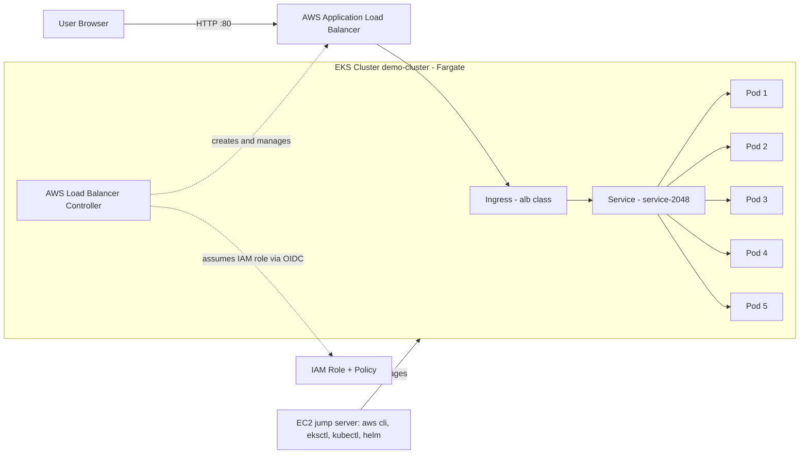
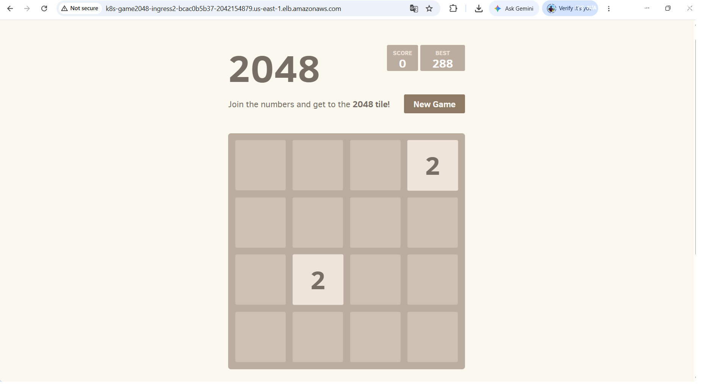
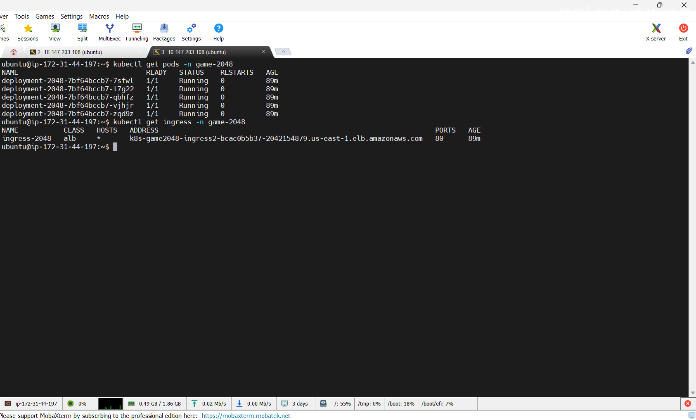
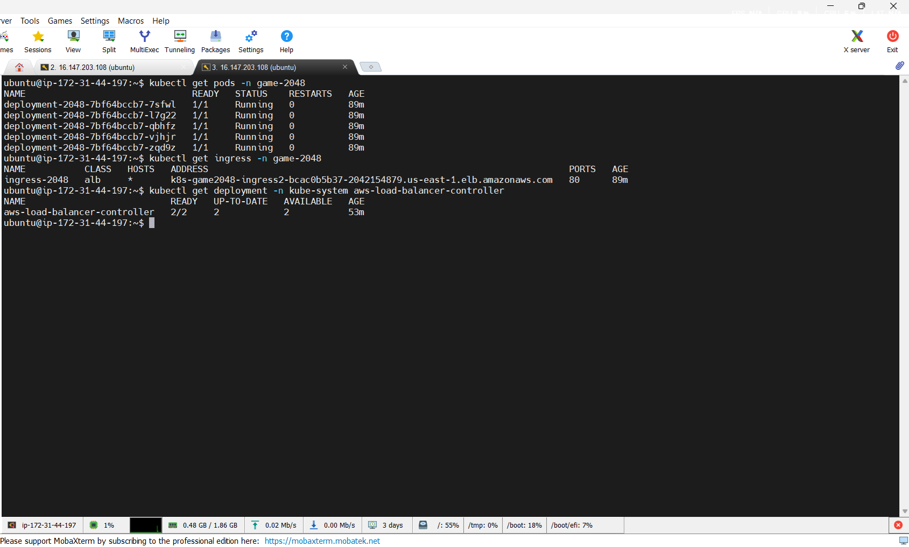
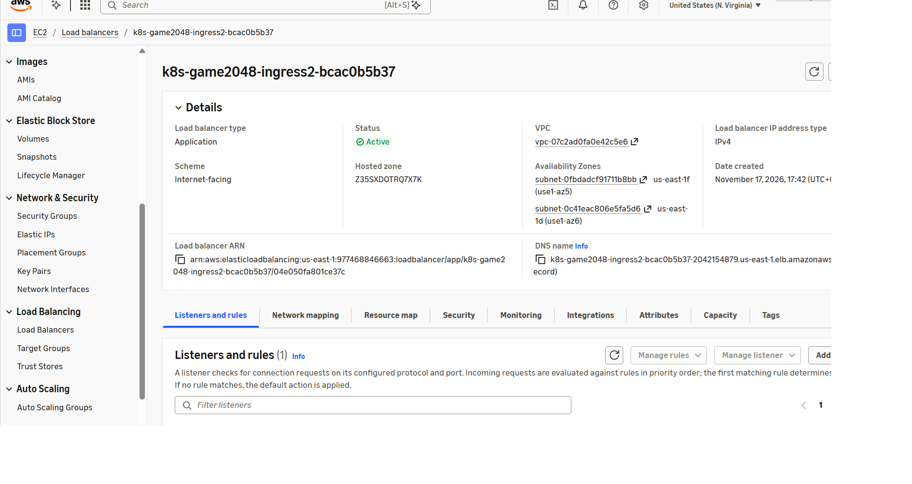
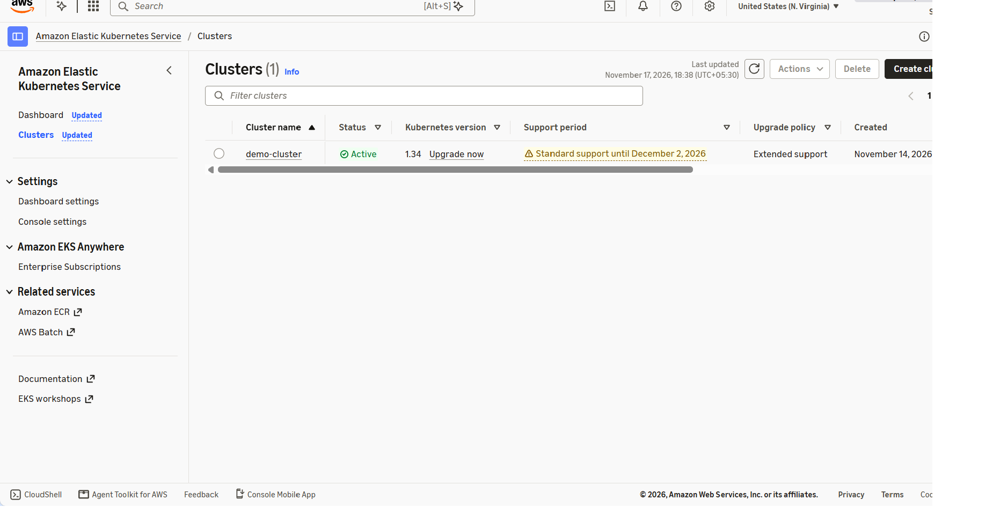

# Kubernetes End-to-End Project on AWS EKS (Fargate + ALB Ingress)

Deploying a containerized application on **Amazon EKS (Fargate)** and exposing it to the internet through an **AWS Application Load Balancer** using the **AWS Load Balancer Controller**.

> Learning project based on Abhishek Veeramalla's *aws-devops-zero-to-hero* (day-22) walkthrough. I ran every step myself and documented the real errors I hit and how I fixed them (see [Troubleshooting](#troubleshooting)).

## Architecture



## Tech stack

- AWS: EC2, EKS, Fargate, IAM (users, roles, OIDC), ALB, CloudFormation
- Kubernetes: Deployment, Service (NodePort), Ingress
- Tools: AWS CLI v2, eksctl, kubectl, Helm
- App: 2048 game (public image)

## Prerequisites

- AWS account and an IAM user (not root) with sufficient permissions, MFA enabled
- An EC2 instance (Ubuntu) used as the jump server
- Region used in this project: `us-east-1`

## Steps

### 1. Install tools on the EC2 jump server

```bash
sudo apt update && sudo apt install unzip curl -y

# AWS CLI
curl "https://awscli.amazonaws.com/awscli-exe-linux-x86_64.zip" -o awscliv2.zip
unzip awscliv2.zip && sudo ./aws/install

# kubectl
curl -LO "https://dl.k8s.io/release/$(curl -L -s https://dl.k8s.io/release/stable.txt)/bin/linux/amd64/kubectl"
sudo install -o root -g root -m 0755 kubectl /usr/local/bin/kubectl

# eksctl
curl -sLO "https://github.com/eksctl-io/eksctl/releases/latest/download/eksctl_Linux_amd64.tar.gz"
tar -xzf eksctl_Linux_amd64.tar.gz && sudo mv eksctl /usr/local/bin

# Helm
sudo snap install helm --classic
```

Configure credentials and region, then verify:

```bash
aws configure            # use the IAM user's access key, region us-east-1
aws sts get-caller-identity
```

### 2. Create the EKS cluster (Fargate)

```bash
eksctl create cluster --name demo-cluster --region us-east-1 --fargate
aws eks update-kubeconfig --name demo-cluster --region us-east-1
kubectl get nodes
```

### 3. Create a Fargate profile for the app namespace

```bash
eksctl create fargateprofile \
  --cluster demo-cluster \
  --region us-east-1 \
  --name alb-sample-app \
  --namespace game-2048
```

### 4. Associate the IAM OIDC provider

```bash
eksctl utils associate-iam-oidc-provider --cluster demo-cluster --approve
```

### 5. IAM policy and service account for the ALB controller

```bash
curl -O https://raw.githubusercontent.com/kubernetes-sigs/aws-load-balancer-controller/v2.11.0/docs/install/iam_policy.json

aws iam create-policy \
  --policy-name AWSLoadBalancerControllerIAMPolicy \
  --policy-document file://iam_policy.json

eksctl create iamserviceaccount \
  --cluster=demo-cluster \
  --namespace=kube-system \
  --name=aws-load-balancer-controller \
  --role-name AmazonEKSLoadBalancerControllerRole \
  --attach-policy-arn=arn:aws:iam::<ACCOUNT_ID>:policy/AWSLoadBalancerControllerIAMPolicy \
  --approve
```

### 6. Install the AWS Load Balancer Controller with Helm

```bash
helm repo add eks https://aws.github.io/eks-charts
helm repo update eks

VPC_ID=$(aws eks describe-cluster --name demo-cluster \
  --query "cluster.resourcesVpcConfig.vpcId" --output text)

helm install aws-load-balancer-controller eks/aws-load-balancer-controller -n kube-system \
  --set clusterName=demo-cluster \
  --set serviceAccount.create=false \
  --set serviceAccount.name=aws-load-balancer-controller \
  --set region=us-east-1 \
  --set vpcId=$VPC_ID

kubectl get deployment -n kube-system aws-load-balancer-controller   # expect 2/2
```

`vpcId` is passed explicitly because on Fargate the controller cannot read it from EC2 metadata.

### 7. Deploy the application

```bash
kubectl apply -f manifests/2048-app.yaml
kubectl get pods -n game-2048
kubectl get ingress -n game-2048     # ADDRESS = ALB DNS name
```

Open `http://<ALB-DNS>` in a browser.

Note: `target-type: ip` is required on Fargate (instance mode does not work).

## Screenshots

### 2048 game running on EKS via ALB


### Pods and Ingress


### AWS Load Balancer Controller


### Application Load Balancer (AWS console)


### EKS cluster


## Troubleshooting

Real issues I hit while building this and how I fixed them.

| Problem | Cause | Fix |
|---|---|---|
| `AWS Region must be set` / `No cluster found for name` | Default region not configured, CLI looked in the wrong region | `aws configure set region us-east-1` and `export AWS_DEFAULT_REGION=us-east-1` |
| Cluster not visible in the AWS console | Console was on a different region (us-west-2) | Switch to `us-east-1` |
| Console: `Error loading resources: Unauthorized` | Console principal had no Kubernetes access on the cluster | Create an EKS access entry and attach `AmazonEKSClusterAdminPolicy` |
| `-bash: demo-cluster: No such file or directory` | Kept the `<` `>` placeholders from the docs in the command | Replace placeholders including the brackets |
| `helm: command not found` | Helm was not installed on the jump server | `sudo snap install helm --classic` |
| Ingress had no ADDRESS: `AccessDenied ... elasticloadbalancing:DescribeListenerAttributes` | IAM policy was from an older controller version (v2.5.4) than the installed controller | Update the policy to v2.11.0 using `aws iam create-policy-version --set-as-default`, then `kubectl rollout restart deployment aws-load-balancer-controller -n kube-system` |
| Ingress event: `no endpoints available for service aws-load-balancer-webhook-service` | Ingress applied before the controller was running | Wait for the controller to be `2/2`; the controller retries automatically |

## Cleanup (avoid AWS charges)

Delete the app first so the ALB is removed, then the cluster:

```bash
kubectl delete -f manifests/2048-app.yaml
helm uninstall aws-load-balancer-controller -n kube-system
eksctl delete cluster --name demo-cluster --region us-east-1
```

Then verify nothing is left: `aws eks list-clusters`, EC2 Load Balancers page, and terminate unused EC2 instances. Deactivate the IAM access keys when done.

## Key learnings

- Fargate specifics: `target-type: ip`, explicit `vpcId`, Fargate profiles per namespace
- How IRSA works: OIDC provider, IAM role, Kubernetes service account
- Keeping IAM policy version in sync with the controller version
- Debugging with `kubectl describe` and controller logs

## Credits

Based on the [aws-devops-zero-to-hero](https://github.com/iam-veeramalla/aws-devops-zero-to-hero) series by Abhishek Veeramalla.
